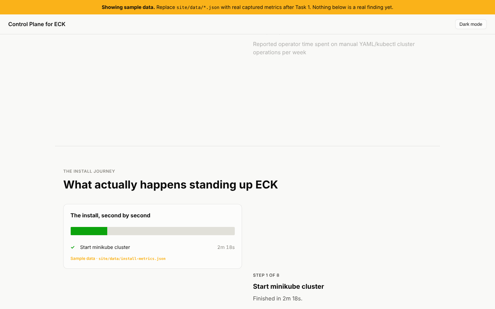

# control-plane-eck

A Senior PM interview take-home: install and analyze Elastic Cloud on Kubernetes
(ECK), then build a working, API-first prototype that lets an operator manage the
resulting Elasticsearch cluster without writing YAML or running kubectl.

**[Open the presentation site](https://nicopavez.github.io/control-plane-eck/)**
(once GitHub Pages is enabled on this repo — see below). It's still showing sample
data until Task 1 is actually run.

**Status: work in progress.** The findings and charts above and below are
placeholders until Task 1 is actually run (see `setup/`) and the prototype is
exercised against a real cluster. Nothing here claims to be a finished result yet.
This project is not affiliated with or endorsed by Elastic.

## What's here

- `setup/` — scripts to stand up a local Kubernetes cluster (minikube) and install
  ECK + a minimal Elasticsearch cluster, timing and logging every step as real
  evidence (`setup/metrics.json`).
- `docs/task1-install-analysis.md` — the install-experience writeup: what worked,
  what didn't, ranked, with evidence.
- `docs/prototype-scope.md` — who the prototype is for, why these operations, what
  was left out on purpose.
- `docs/market-context.md` — sourced data on why operator UX for stateful
  Kubernetes services matters.
- `docs/presentation-outline.md` — the 30-minute presentation script.
- `packages/shared` — the TypeScript contract (types + typed client) everything
  else builds against.
- `packages/api` — a Fastify service wrapping the Kubernetes and Elasticsearch
  APIs: cluster status, credentials, scaling, version upgrades, index management.
- `packages/tui` — an Ink terminal client, the primary live-demo surface.
- `packages/web` — an optional, minimal operational UI on the same API (stretch).
- `site/` — the interactive scrollytelling presentation site, charts built only
  from real captured data (`setup/metrics.json`, `setup/operation-timing.json`),
  in the style of [The Pudding](https://pudding.cool/2025/04/wine-animals/)'s
  scroll-driven storytelling, via [Scrollama](https://github.com/russellgoldenberg/scrollama).

## Running it locally

Everything runs on your own machine; this can't run inside a cloud container (no
Docker daemon there).

1. Install [Docker Desktop](https://www.docker.com/products/docker-desktop/) (free
   for personal use), [minikube](https://minikube.sigs.k8s.io/docs/start/), and
   [kubectl](https://kubernetes.io/docs/tasks/tools/).
2. `npm install` at the repo root (npm workspaces installs every package).
3. `cp .env.example .env` and fill in real values.
4. Run `setup/` in order (see `setup/README.md`) to get a real local ECK +
   Elasticsearch cluster, and `npm run render-charts` to turn the captured metrics
   into charts.
5. `npm run dev --workspace=packages/api` to start the API, then
   `npm run dev --workspace=packages/tui` for the terminal client, or
   `npm run dev --workspace=site` for the presentation site.

## Deploying the presentation site

`.github/workflows/pages.yml` builds and deploys `site/` to GitHub Pages on every
push to `main`. One-time setup: in this repo's Settings -> Pages, set **Source** to
**GitHub Actions**. After that the live-demo link above stays current automatically.

## Security notes

- No secrets are ever committed. Kubernetes credentials and TLS certs are read
  live from the cluster by `packages/api` and never written to disk, logs, or git.
- Configuration is environment variables only (`.env`, gitignored; see
  `.env.example` for the documented keys). `packages/api` validates required env
  vars at startup and fails fast rather than silently defaulting.
- `setup/metrics.json` is scrubbed of secret-shaped values before being written.
- CI (`.github/workflows/ci.yml`) runs lint, typecheck, build, and tests on every
  push; GitHub's secret scanning stays on for this public repo.

## License

MIT, see `LICENSE`.
